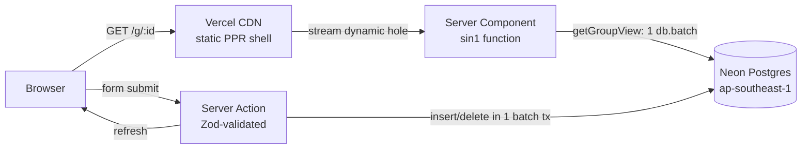

# Hatian: split bills with your barkada

**Live:** https://hatian-liard.vercel.app

Hatian (Filipino for "splitting" or "sharing") tracks shared expenses for trips, boarding-house bills, group dinners, and office pasalubong runs. Nobody signs up. You create a group, send the link to the group chat, and anyone with the link can add what they paid. Hatian keeps the running balances and lists the fewest payments that settle everyone.

## Features

- **No account needed.** The group link is the key. It's a 12-character random id (about 71 bits), so it can't be guessed.
- **Optional Google sign-in** (Neon Auth). Signing in saves every group you open or create to your account, so they follow you across phones and laptops. Groups you opened on this device before signing in are imported automatically.
- **"This is me".** Link your account to your name in each group. Hatian then shows what *you* owe or get back in that group, and totals it across all your groups on **My groups** (`/groups`).
- **Excel export.** Every group page has *Export to Excel*: a workbook with Summary (balances + suggested payments), Expenses (one share column per person), and Payments sheets. Signed-in users can export **all** their groups at once from My groups. Amounts are real numbers with currency formats and dates are real dates, so sums, filters, and pivots work.
- **Three ways to split an expense:**
  - Equally, among any subset of people.
  - By exact amounts.
  - By shares, e.g. 2:1:1 when one person brought a plus-one.
- **Exact money math.** Amounts are stored as integer minor units (centavos). Leftover centavos go to specific people by rule, so every split adds up to the total exactly.
- **Fewest-payments settle up.** It matches equal debts first, then has the largest debtor pay the largest creditor. That takes at most *n-1* payments.
- **One-tap "Mark as paid".** Recording a repayment updates every balance right away.
- **Multi-currency groups.** PHP is the default. USD, EUR, JPY (no decimals), KRW, SGD, and others also work.
- **Recent groups on your device.** Visited groups are saved in localStorage, so you can reopen them from the home page.

## Stack

| Layer | Choice | Why |
|---|---|---|
| Framework | **Next.js 16.4** (App Router, Turbopack, `cacheComponents`/PPR) | The static shell comes from the CDN while the group data streams in. Server Actions mean there are no hand-written API routes. |
| UI | **React 19.3**, **Tailwind CSS v4** (CSS-first `@theme`), **lucide-react** icons | `useActionState`/`useFormStatus` forms work without client fetch code. There's no component library to download. |
| Auth | **Neon Auth** (Managed Better Auth) with Google OAuth via `@neondatabase/auth` | Users and sessions live in the `neon_auth` schema of the same database, so `group_follows.user_id` is a real foreign key. The browser talks to it through the same-origin `/api/auth/*` proxy. |
| Excel | **write-excel-file** | Small, maintained, streams `.xlsx` from a route handler with number and date formats. |
| Database | **Neon Postgres 18** (Singapore, `aws-ap-southeast-1`) | Serverless and branchable. `uuidv7()` ids are time-ordered, so `ORDER BY id` gives insertion order. |
| ORM / driver | **Drizzle ORM** + `@neondatabase/serverless` HTTP driver | One HTTP request per `db.batch`, and there's no connection pool to manage in functions. Migrations are SQL files in `drizzle/`. |
| Validation | **Zod 4** | Each server action parses the untrusted `FormData` before it touches the database. |
| Hosting | **Vercel** (Fluid compute), functions pinned to **`sin1`** | The functions run in the same city as the database, so each query is a short local hop. |
| Tooling | **bun**, **Biome**, **Vitest** | Fast installs, a single lint+format tool, and tests for the money math. |

## Architecture



- `src/db/schema.ts` defines six tables: `groups`, `members`, `expenses`, `expense_shares`, `settlements`, and `group_follows` (account ↔ group, plus the optional linked member). Composite foreign keys `(group_id, member_id)` make it impossible to attach an expense, repayment, or "this is me" link to someone from another group. A unique index allows only one account per member. Check constraints keep amounts positive and stop anyone from repaying themselves.
- `src/lib/data.ts`: `getGroupViews(ids)` loads any number of groups (members, expenses, shares, repayments) in **one round trip**. The `db.batch` runs as a single read transaction. It then computes balances and suggested transfers, so the dashboard, My groups, and both Excel exports use the same math. Reads are deliberately uncached because everyone edits the same ledger.
- `src/lib/ledger.ts` holds the pure split and settle-up math. The server uses it for storage and the expense form uses it for a live preview, so both always agree.
- `src/lib/account.ts` reads the session (`getSessionUser`), the viewer of a group (`getGroupViewer`), and the account overview (`getMyGroups`). `src/app/actions/account.ts` saves groups to the account, imports device history, and links "this is me".
- `src/lib/export.ts` builds the workbooks. The routes are `GET /g/:id/export` (anyone with the link) and `GET /groups/export` (signed in only; returns 401 otherwise).
- `src/proxy.ts` sends signed-out visitors of `/groups` to `/sign-in`. Group pages stay public.
- `src/app/actions/*` holds the Server Actions. Each one validates input, checks that every member id belongs to the group, writes in one batch (an expense and its shares are atomic), then calls `refresh()`.
- Pages render a static shell. Anything that reads the database or the session sits behind `<Suspense>`, as `cacheComponents` requires.

## Local development

```bash
bun install
cp .env.example .env.local   # DATABASE_URL, NEON_AUTH_BASE_URL, NEON_AUTH_COOKIE_SECRET
bun run db:migrate           # applies drizzle/*.sql
bun run dev                  # http://localhost:3000
```

| Script | What it does |
|---|---|
| `bun run test` | Vitest: split rounding, settle-up, and money parsing |
| `bun run typecheck` | `tsc --noEmit` |
| `bun run lint` | Biome lint and format check |
| `bun run db:generate` | Generate a new SQL migration after editing `src/db/schema.ts` |
| `bun run db:studio` | Drizzle Studio against your database |

## Deployment

Pushes to `main` deploy to production through Vercel's Git integration. Environment variables on Vercel (Production, Preview, Development):

| Variable | Type | Value |
|---|---|---|
| `DATABASE_URL` | secret | Neon pooled connection string |
| `NEON_AUTH_BASE_URL` | config | Branch Auth URL from Neon Console → Auth |
| `NEON_AUTH_COOKIE_SECRET` | secret | 32+ random bytes (`openssl rand -base64 32`) |

Run schema changes with `bun run db:generate` followed by `bun run db:migrate` before you push code that depends on them.

### Google sign-in for production

Google sign-in currently uses **Neon's shared development OAuth app**, so Google's consent screen shows Neon's name. To show "Hatian" instead:

1. In Google Cloud Console, create an OAuth client (Web application). For the authorized redirect URI, copy the value shown in Neon Console → Auth → OAuth providers → Google. It is normally `https://ep-wispy-heart-az4uvmez.neonauth.c-3.ap-southeast-1.aws.neon.tech/neondb/auth/callback/google`.
2. Run `neon neon-auth oauth-provider add --project-id delicate-salad-68929211 --provider-id google --oauth-client-id <id> --oauth-client-secret <secret>`.
3. Fill in the OAuth consent screen branding and publish it.

Every origin that signs in must be a Neon Auth trusted domain (`neon neon-auth domain add https://…`). `https://hatian-liard.vercel.app` is registered, and localhost is allowed by default.

## Security model and limits

- Anyone holding the link can view, edit, and export the group, just as with any shared-link tool. Share it only with the group. Signing in adds convenience (tracking, totals, export-all), not access control.
- Email/password sign-up is disabled on Neon Auth, so only Google accounts exist. This prevents someone from pre-registering a victim's email with a password before the victim's first Google sign-in.
- Server Actions treat all input as untrusted. Every write is scoped by `group_id`, and the database rejects cross-group references.
- There's no rate limiting yet. Add Vercel Firewall rate-limit rules if the app is ever opened up widely.
