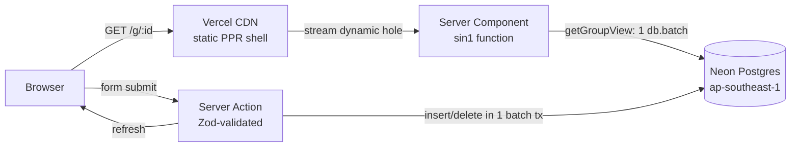

# Hatian: split bills with your barkada

**Live:** https://hatian-liard.vercel.app

Hatian (Filipino for "splitting" or "sharing") tracks shared expenses for trips, boarding-house bills, group dinners, and office pasalubong runs. Nobody signs up. You create a group, send the link to the group chat, and anyone with the link can add what they paid. Hatian keeps the running balances and lists the fewest payments that settle everyone.

## Features

- **No accounts.** The group link is the key. It's a 12-character random id (about 71 bits), so it can't be guessed.
- **Three ways to split an expense:**
  - Equally, among any subset of people.
  - By exact amounts.
  - By shares, e.g. 2:1:1 when one person brought a plus-one.
- **Exact money math.** Amounts are stored as integer minor units (centavos). Leftover centavos go to specific people by rule, so every split adds up to the total exactly.
- **Fewest-payments settle up.** It matches equal debts first, then has the largest debtor pay the largest creditor. That takes at most *n-1* payments.
- **One-tap "Mark as paid".** Recording a repayment updates every balance right away.
- **Multi-currency groups.** PHP is the default. USD, EUR, JPY (no decimals), KRW, SGD, and others also work.
- **Recent groups on your device.** Visited groups are saved in localStorage, so you can reopen them from the home page.

## Stack

| Layer | Choice | Why |
|---|---|---|
| Framework | **Next.js 16.4** (App Router, Turbopack, `cacheComponents`/PPR) | The static shell comes from the CDN while the group data streams in. Server Actions mean there are no hand-written API routes. |
| UI | **React 19.3**, **Tailwind CSS v4** (CSS-first `@theme`) | `useActionState`/`useFormStatus` forms work without client fetch code. There's no component library to download. |
| Database | **Neon Postgres 18** (Singapore, `aws-ap-southeast-1`) | Serverless and branchable. `uuidv7()` ids are time-ordered, so `ORDER BY id` gives insertion order. |
| ORM / driver | **Drizzle ORM** + `@neondatabase/serverless` HTTP driver | One HTTP request per `db.batch`, and there's no connection pool to manage in functions. Migrations are SQL files in `drizzle/`. |
| Validation | **Zod 4** | Each server action parses the untrusted `FormData` before it touches the database. |
| Hosting | **Vercel** (Fluid compute), functions pinned to **`sin1`** | The functions run in the same city as the database, so each query is a short local hop. |
| Tooling | **bun**, **Biome**, **Vitest** | Fast installs, a single lint+format tool, and tests for the money math. |

## Architecture



- `src/db/schema.ts` defines five tables: `groups`, `members`, `expenses`, `expense_shares`, and `settlements`. Composite foreign keys `(group_id, member_id)` make it impossible to attach an expense or repayment to someone from another group. Check constraints keep amounts positive and stop anyone from repaying themselves.
- `src/lib/data.ts`: `getGroupView(id)` loads the group, members, expenses, shares, and repayments in **one round trip**. The `db.batch` runs as a single read transaction. It then computes balances and suggested transfers. The result is deliberately uncached because everyone edits the same ledger. React `cache()` dedupes the call between `generateMetadata` and the page.
- `src/lib/ledger.ts` holds the pure split and settle-up math. The server uses it for storage and the expense form uses it for a live preview, so both always agree.
- `src/app/actions/*` holds the Server Actions. Each one validates input, checks that every member id belongs to the group, writes in one batch (an expense and its shares are atomic), then calls `refresh()`.
- `src/app/g/[id]/page.tsx` renders the shell statically. The dashboard sits behind `<Suspense>`, as `cacheComponents` requires.

## Local development

```bash
bun install
cp .env.example .env.local   # paste your Neon pooled connection string
bun run db:migrate           # applies drizzle/*.sql
bun run dev                  # http://localhost:3000
```

| Script | What it does |
|---|---|
| `bun run test` | Vitest: split rounding, settle-up, and money parsing |
| `bun run typecheck` | `tsc --noEmit` |
| `bun run lint` | Biome lint and format check |
| `bun run db:generate` | Generate a new SQL migration after editing `src/db/schema.ts` |
| `bun run db:studio` | Drizzle Studio against your database |

## Deployment

Pushes to `main` deploy to production through Vercel's Git integration. `DATABASE_URL` is stored as a Vercel **secret** env var for Production, Preview, and Development. Run schema changes with `bun run db:generate` followed by `bun run db:migrate` before you push code that depends on them.

## Security model and limits

- Anyone holding the link can view and edit the group, just as with any shared-link tool. Share it only with the group.
- Server Actions treat all input as untrusted. Every write is scoped by `group_id`, and the database rejects cross-group references.
- There's no rate limiting yet. Add Vercel Firewall rate-limit rules if the app is ever opened up widely.
